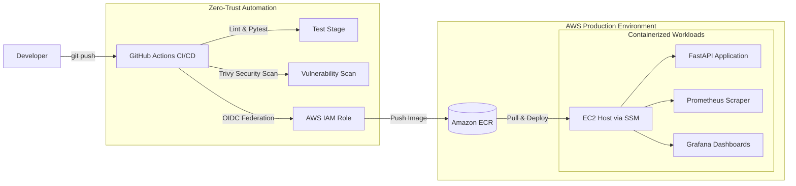

# CloudOps — Automated Cloud Deployment & Reliability Platform

[](https://fastapi.tiangolo.com)
[](https://www.docker.com/)
[](https://www.terraform.io/)
[](https://prometheus.io/)
[](https://grafana.com/)
[](https://aws.amazon.com/)

CloudOps is an enterprise-aligned, automated cloud deployment, observability, and Site Reliability Engineering (SRE) platform. It demonstrates automated Infrastructure-as-Code (Terraform), secure multi-stage containerization (Docker), zero-credential CI/CD pipelines (GitHub Actions OIDC), telemetry/metrics instrumentation (Prometheus & Grafana), and resilient rollback/recovery strategies on AWS.

---

## Architecture Overview



---

## Repository Structure

```text
cloudops-platform/
├── app/                  # FastAPI Application Source Code
│   ├── routes/           # API Endpoints (Health, Info, Core)
│   ├── services/         # Business Logic & Reliability Helpers
│   ├── config.py         # Environment-driven Configuration (Pydantic)
│   └── main.py           # Application Entrypoint & Prometheus Middleware
├── tests/                # Automated Pytest Suite (Unit & Integration)
├── monitoring/           # Observability Configurations
│   ├── prometheus/       # Prometheus Config & Alerting Rules
│   └── grafana/          # Provisioned Dashboards & Datasources
├── docker/               # Docker configurations & helper scripts
├── terraform/            # Infrastructure-as-Code
│   ├── bootstrap/        # S3 Remote State & DynamoDB Locks
│   ├── modules/          # Reusable Modules (VPC, Security Groups, EC2, ECR, IAM)
│   └── environments/     # Environment-specific configs (e.g. dev, prod)
├── scripts/              # Operational & verification scripts
├── docs/                 # SRE Architecture, Security, and Incident Runbooks
│   ├── architecture/
│   ├── deployment/
│   ├── security/
│   ├── troubleshooting/
│   └── incidents/
├── .github/              # Automation
│   └── workflows/        # CI & CD Pipeline definitions
├── Dockerfile            # Multi-stage, non-root minimal container
├── compose.yaml          # Local stack (App + Prometheus + Grafana)
├── requirements.txt      # Production dependencies
├── requirements-dev.txt  # Testing, linting, and development dependencies
├── .dockerignore         # Build context optimization
├── .gitignore            # Git exclusion rules
└── README.md             # Project documentation
```

---

## Core Capabilities

1. **Production-grade API**: FastAPI service instrumented with custom Prometheus metrics (request counters, status codes, latency histograms) and distinct liveness/readiness probes (`/health`, `/ready`).
2. **Hardened Containerization**: Distroless/minimal non-root image scanning clean with Trivy vulnerability scanning.
3. **Reproducible IaC**: Modular Terraform configurations following AWS Well-Architected framework (strict security groups, VPC networking, IAM least privilege).
4. **Zero-Trust CI/CD**: Automated GitHub Actions pipelines utilizing AWS OIDC authentication (no long-lived secret access keys).
5. **Observability & Alerting**: Out-of-the-box telemetry with Prometheus scrape targets and pre-provisioned Grafana operational dashboards.
6. **SRE Runbooks & Rollback**: Simulated failure drills, incident reports, and automated rollback workflows.

---

## Local Development Quickstart

### Prerequisites
- Python 3.11+
- Docker Desktop & Docker Compose
- Git

### 1. Setup Virtual Environment
```powershell
python -m venv .venv
.\.venv\Scripts\Activate.ps1
pip install -r requirements.txt -r requirements-dev.txt
```

### 2. Run Locally
```powershell
uvicorn app.main:app --reload --host 0.0.0.0 --port 8000
```

### 3. Run with Docker Compose
```powershell
docker compose up --build -d
```
Access endpoints:
- Application API: `http://localhost:8000`
- API Metrics: `http://localhost:8000/metrics`
- Prometheus: `http://localhost:9090`
- Grafana: `http://localhost:3000` (Default credentials: `admin / admin`)

---

## Testing & Quality Assurance
```powershell
# Run test suite
pytest -v

# Run lint checks
flake8 app tests
```

---

## License
MIT License. Developed as a production-grade portfolio platform.
